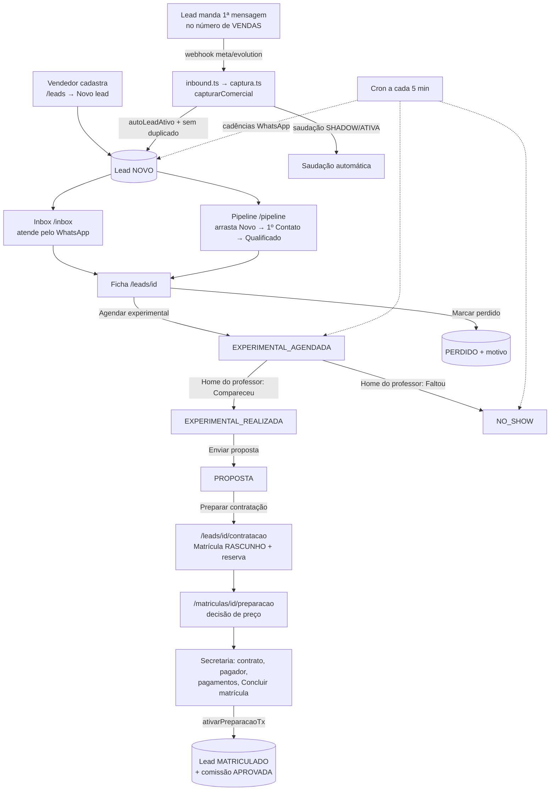

# Guia do fluxo de CRM — telas, componentes e backend

> Documento de handoff para programadores: **onde fica cada tela no front, quais botões, modais e
> painéis ela tem, como ela se parece e qual código do backend cada ação chama.**
>
> Base: leitura estática do commit `f8a9c0e` (`main`, 13/10/2026). Nada foi executado (sem
> testes, sem app rodando). "Implementado" significa "existe código", não "homologado".
> Referências no formato `arquivo:linha` são aproximadas — conferir no commit indicado.
>
> Documentação de produto relacionada: [`08-comercial-crm-whatsapp.md`](08-comercial-crm-whatsapp.md)
> (regras de negócio desejadas), [`18-design-system.md`](18-design-system.md) (padrão visual),
> [`27-comercial-automacoes-ia.md`](27-comercial-automacoes-ia.md) (automações/IA).

---

## Sumário

1. [Arquitetura em 1 minuto](#1-arquitetura-em-1-minuto)
2. [Parte gráfica — design system e componentes comuns](#2-parte-gráfica--design-system-e-componentes-comuns)
3. [Mapa do fluxo](#3-mapa-do-fluxo)
4. [Menu lateral e papéis](#4-menu-lateral-e-papéis)
5. [Máquina de etapas do lead](#5-máquina-de-etapas-do-lead)
6. [Telas](#6-telas)
   - 6.1 [Home (por papel)](#61-home--home-versões-por-papel)
   - 6.2 [Lista de leads + Novo lead](#62-lista-de-leads--leads)
   - 6.3 [Pipeline (Kanban)](#63-pipeline-kanban--pipeline)
   - 6.4 [Ficha do lead (+ Copiloto + Fechamento)](#64-ficha-do-lead--leadsid)
   - 6.5 [Inbox WhatsApp](#65-inbox-whatsapp--inbox)
   - 6.6 [Preparar contratação](#66-preparar-contratação--leadsidcontratacao)
   - 6.7 [Proposta da contratação](#67-proposta-da-contratação--matriculasidpreparacao)
   - 6.8 [Reserva de vaga](#68-reserva-de-vaga--matriculasidreserva)
   - 6.9 [Contrato e ativação (Secretaria)](#69-contrato-e-ativação-secretaria)
   - 6.10 [Carteiras e coberturas](#610-carteiras-e-coberturas--carteiras)
   - 6.11 [Comissões](#611-comissões--comissoes)
   - 6.12 [Empresas (B2B)](#612-empresas-b2b--empresas-e-empresasid)
   - 6.13 [Configuração comercial](#613-configuração-comercial--configuracaowhatsappcomercial)
   - 6.14 [Réguas comerciais](#614-réguas-comerciais--configuracaowhatsappreguas)
7. [Backend sem tela: captura, cron e cadências](#7-backend-sem-tela-captura-cron-e-cadências)
8. [Inventário de modais, drawers e confirmações](#8-inventário-de-modais-drawers-e-confirmações)
9. [Achados e divergências (para priorizar)](#9-achados-e-divergências-para-priorizar)
10. [Índice rápido de arquivos](#10-índice-rápido-de-arquivos)

---

## 1. Arquitetura em 1 minuto

| Camada | Onde | Padrão |
|---|---|---|
| Rotas/telas | `src/app/(app)/<rota>/page.tsx` | Next.js App Router. `page.tsx` é **Server Component**: aplica o guard e chama as *consultas*. |
| Componentes interativos | `src/app/(app)/<rota>/*.tsx` com `"use client"` | Chamam **Server Actions** via `useAcaoCliente` (`src/lib/acao-cliente.ts`), que bloqueia duplo clique e trata falha de rede. |
| Leitura | `src/server/<domínio>/consultas.ts` | Sempre recebe o usuário e aplica escopo (carteira). |
| Gravação | `src/server/<domínio>/acoes.ts` | `executarAcao` → `exigirSessao` → `exigirPapel` → zod (`schema.ts`) → `prisma.$transaction` → `registrarEvento` → `revalidatePath`. |
| Regras puras | `src/server/_shared/regras.ts` | Máquina de etapas, check-in, alocação de pagamento. |
| Escopo comercial | `src/server/_shared/escopo-comercial.ts` | Vendedor = próprios leads + carteiras que cobre; Gerente = equipe; Admin = tudo. |
| Banco | `prisma/schema.prisma` | `model Lead` (~l.1313), enums `EtapaLead`, `Temperatura`, `MotivoPerda`, `Segmento`. |
| Auditoria | tabela de eventos | Toda ação grava evento (`LeadCriado`, `EtapaAlterada`, `ExperimentalAgendada`, `LeadPerdido`…). A **Linha do tempo** da ficha é a leitura desses eventos. |
| Automação | `src/app/api/whatsapp/webhook/*` e `src/app/api/whatsapp/cron/route.ts` | Webhook captura lead; cron (a cada 5 min) enfileira cadências; `despachante.ts` envia. |

**Guards de página** (`src/server/_shared/sessao.ts`):
- `exigirSessaoPagina(...papeis)` — sem sessão → `/login`; usuário de portal → `/portal`; papel errado → `/acesso-negado`.
- `exigirPapelLeitura(...)` (`src/lib/guards.ts`) — renderiza `<AcessoNegado>` no lugar da tela.
- **ADMINISTRADOR passa em qualquer `temPapel`/`exigirPapel`.**

**Mensagens padrão das ações:**
- Erro de validação/regra: a mensagem do zod/`ErroRegra` aparece em `FeedbackAcao` (caixa vermelha) junto do botão.
- Erro desconhecido: "Erro inesperado. Tente novamente."
- Falha de rede sem idempotência: "Resultado não confirmado. Recarregue a página e veja se a operação já aparece antes de repetir." (`src/lib/mensagens.ts:10`).
- Na maioria das telas do CRM **o sucesso não mostra mensagem** — só `router.refresh()`.

---

## 2. Parte gráfica — design system e componentes comuns

**Princípios** (`docs/18-design-system.md`, `tailwind.config.ts`, `src/app/globals.css`):
- Flat e minimalista: **sem sombra, sem gradiente**, bordas de 1px (`--border`), cantos 8–12px (`rounded-md/lg/xl`), chips `rounded-full`.
- **Tokens via CSS variables** com tema claro/escuro (classe `.dark`, toggle no rodapé da Sidebar). Nunca hex solto no componente.
- **Sentence case sempre** (sem Title Case nem caixa alta). Fonte Anthropic Sans, pesos 400 e 500 apenas.
- Ícones **Tabler outline** (`@tabler/icons-react`), `h-4 w-4` padrão.
- Marca: índigo (`--brand #4338ca`). Página `#fafaf7`, cartões `bg-surface` (branco).
- Cor própria para IA (roxo `ai-*`) — tudo que é sugestão do copiloto usa essa identidade.

**Shell** (`src/app/(app)/layout.tsx`): Sidebar à esquerda (≥ md) ou `BarraMobile` no topo (celular); `<main className="p-4 md:p-8">` com `Trilha` (breadcrumb) e link "Pular para o conteúdo".

**Cores semânticas usadas no CRM**

| Uso | Classes | Onde |
|---|---|---|
| Temperatura Quente / Morno / Frio | `bg-red-100 text-red-700` / `bg-amber-100 text-amber-700` / `bg-blue-100 text-blue-700` | `TEMPERATURA_CLS` em `src/lib/labels.ts:129` |
| Chip B2B | `bg-indigo-100 text-indigo-700` | Ficha do lead, ficha da empresa |
| Segmento | `bg-gray-100 text-gray-600` | Ficha do lead |
| Etapa atual na trilha | `bg-brand-solid text-white` | Ficha do lead |
| Perdido / No-show | `bg-red-100 text-red-700` / `bg-orange-100 text-orange-700` | Ficha do lead |
| Coluna "gargalo" no Kanban (Novo, Exp. Agendada, Proposta) | `bg-amber-50 text-amber-800` | Pipeline |
| Selo SLA | `bg-red-100 text-red-600` + `IconAlertTriangle` | Card do Kanban |
| Copiloto IA | `border-ai-200 bg-ai-100/60`, botão `bg-ai-solid` | Ficha e Inbox |
| Notas internas | `border-amber-200 bg-amber-50` + `IconLock` | Inbox |
| Card Fechamento | `border-blue-200 bg-blue-50/50` | Ficha do lead |

**Rótulos** (`src/lib/labels.ts`):
- Etapa (curta, Kanban): Novo · 1º Contato · Qualificado · Exp. Agendada · Exp. Realizada · Proposta · Aguardando Matrícula · Matriculado · No-show · Perdido.
- Motivo de perda: Não respondeu · Preço · Tempo/Horário · Concorrência · Sem interesse · Localização · Empresa (B2B) · Qualificação · Outro.
- Segmento: Adulto · Kids · Teens · Empresa.

**Componentes compartilhados** (`src/components/`)

| Componente | O que é | Visual / comportamento |
|---|---|---|
| `Botao.tsx` (`botaoClasses`) | Botão do design system | Variantes: **primário** `bg-brand-solid text-white`; **secundário** `border-gray-300 bg-surface`; **perigo** `bg-danger text-white`; **fantasma** `text-brand-700`. Tamanhos sm/md/lg. No celular `min-h-10`. |
| `Modal.tsx` | Modal centralizado | Overlay `bg-black/30`, cartão `max-w-md`, `max-h-[90dvh]` com rolagem. Escape/fundo fecham (exceto com `bloquearFechamento`). Foco preso. |
| `ConfirmarAcao.tsx` | Confirmação de ação irreversível | Modal `alertdialog`. Botões "Voltar" (secundário, foco inicial) e "Confirmar {x}" (perigo → "Confirmando…"). Erro aparece dentro do modal. |
| `Drawer.tsx` | Painel lateral (45% da tela) | **Não é usado em nenhuma tela do CRM.** |
| `FeedbackAcao.tsx` | Resultado de ação | Erro `bg-red-50 text-red-700` (recebe foco e rola até ele); sucesso `bg-green-50 text-green-700`. |
| `EstadoVazio.tsx` | "Nada aqui" | Caixa tracejada; variante `bloco` maior e centralizada. |
| `Esqueleto.tsx` | Loading com formato da tela | `EsqueletoLista`, `EsqueletoTabela`, `EsqueletoCartoes`, `EsqueletoColunas`, `EsqueletoConversas`. |
| `Paginacao.tsx` | "← Anterior · Página N · Próxima →" | Some com uma página só. Links reais. |
| `ColunaOrdenavel.tsx` | Cabeçalho ordenável | Seta `IconArrowUp/Down/ArrowsSort`. |
| `ErroArea.tsx` | Erro de rota | Título + "A consulta falhou ou o servidor não respondeu…" + botão "Tentar de novo" + link de volta. |
| `VoltarPara.tsx` | Link "← Destino" | — |
| `CopilotoSugestoes.tsx` | Sugestões da IA | Ver 6.4.1. |
| `UploadArquivo.tsx` | Upload | PDF/JPG/PNG até 10 MB → `POST /api/upload`. |
| `PagamentoModal.tsx` | Registrar recebimento | Usado na Inbox (financeiro). |
| `ExportarPlanilha.tsx` | Link de exportação .xlsx | Lista de leads. |

> **Regra geral observada:** no CRM quase nada é modal. Formulários abrem como **painéis inline**
> (abre/fecha no mesmo card). `ConfirmarAcao` só aparece em ações de efeito externo/irreversível
> (opt-out, vínculo, faltou na experimental, revogar cobertura, ativar saudação/régua, faturas B2B).

---

## 3. Mapa do fluxo

Em texto, a jornada e quem toca cada passo:

| # | Passo | Tela (front) | Backend principal |
|---|---|---|---|
| 1 | Entrada do lead | automático (webhook) ou `/leads` → "Novo lead" | `captura.ts:capturarComercial`, `comercial/acoes.ts:criarLead` |
| 2 | Atendimento | `/inbox` | `whatsapp/acoes.ts:enviarTextoInbox`, `criarLeadDaConversa` |
| 3 | Qualificação | `/pipeline` (arraste), `/leads/[id]`, cockpit da Inbox | `comercial/acoes.ts:moverEtapa`, `definirTemperatura`, `atualizarResumo` |
| 4 | Experimental | Ficha → "Agendar experimental"; Home do professor → check-in | `agendarExperimental`, `checkinExperimental` |
| 5 | Proposta | Ficha → "Enviar proposta" | `enviarProposta` |
| 6 | Contratação | `/leads/[id]/contratacao` → `/matriculas/[id]/preparacao` → `/reserva` | `matricula/preparacao-comercial.ts`, `preparacao-preco.ts`, `reserva-comercial.ts` |
| 7 | Fechamento | Card "Fechamento" na ficha (link de pagamento); Secretaria (contrato, ativação) | `matricula/acoes.ts:registrarLinkPagamento`, `concluirMatricula` → `ativacao-preparacao-tx.ts` |
| 8 | Perda | Ficha, Kanban → "Marcar perdido" | `marcarPerdido` |
| 9 | Automações | (sem tela) cron + configuração em `/configuracao/whatsapp/comercial` e `/reguas` | `whatsapp/cron-comercial.ts`, `cron-gestao.ts`, `ia/copiloto.ts` |

---

## 4. Menu lateral e papéis

Fonte: `src/lib/nav.ts` (o menu **só esconde**; quem barra é o guard da página).

| Item | Rota | Ícone | Papéis no menu | Guard real da página |
|---|---|---|---|---|
| Home | `/home` | Home | todos | qualquer sessão |
| Pipeline | `/pipeline` | KanbanSquare | ADM, GC, VEND | qualquer sessão (lista vazia sem papel comercial) |
| Leads | `/leads` | Users | ADM, GC, VEND | VEND, GC |
| Inbox | `/inbox` | MessageCircle | ADM, GC, VEND, FIN, SEC, PROF, GP | `PAPEIS_INBOX` (os mesmos) |
| Matrículas | `/secretaria` | UserCheck | ADM, SEC, VEND, GC | — |
| Carteiras | `/carteiras` | Users | ADM, GC | GC |
| Comissões | `/comissoes` | Wallet | ADM, FIN, GC, VEND | VEND, GC, FIN |
| Empresas | `/empresas` | — | ADM, GC, FIN, SEC | **só FIN** (GC/SEC veem "Acesso negado") |
| Configuração | `/configuracao` | Settings | ADM, GP, GC, SEC | GC só vê a aba WhatsApp |

Legenda: ADM administrador · GC gerente comercial · VEND vendedor · FIN financeiro · SEC secretaria acadêmica · PROF professor · GP gerente pedagógico.

Badge de não lidas da Inbox: pílula `bg-brand-solid text-white` na Sidebar ("99+" acima de 99); ponto na BarraMobile.

---

## 5. Máquina de etapas do lead

Enum `EtapaLead` (`prisma/schema.prisma`). Regras em `src/server/_shared/regras.ts:355-386`
(`TRANSICOES_MANUAIS`, `ehEtapaManual`, `transicaoManualPermitida`) e `src/server/comercial/schema.ts:184` (`ETAPAS_MANUAIS`).

**Etapas manuais (arrastáveis / select "Mudar etapa"):** Novo, 1º Contato, Qualificado, Exp. Agendada.

| De | Destinos manuais permitidos |
|---|---|
| Novo | 1º Contato |
| 1º Contato | Novo, Qualificado |
| Qualificado | 1º Contato, Exp. Agendada |
| Exp. Agendada | Qualificado |
| Exp. Realizada | Qualificado, Exp. Agendada |
| No-show | Qualificado, Exp. Agendada |
| Proposta | Qualificado, Exp. Agendada |
| Aguardando Matrícula | Proposta *(não é manual → na prática nenhuma saída)* |
| Perdido / Matriculado | nenhuma |

**Etapas geradas por ação (não arrastáveis):**

| Etapa | Gerada por | Função |
|---|---|---|
| Exp. Agendada | Ficha → "Agendar experimental" (também é manual) | `comercial/acoes.ts:agendarExperimental` (l.426) |
| Exp. Realizada / No-show | Home do professor → "Compareceu" / "Faltou" | `comercial/acoes.ts:checkinExperimental` (l.593) |
| Proposta | Ficha → "Enviar proposta" | `comercial/acoes.ts:enviarProposta` (l.485) |
| Aguardando Matrícula | **só o caminho legado** `/matriculas/nova` | `matricula/acoes.ts:criarMatriculaTx` (l.391) |
| Matriculado | Ativação da matrícula (Secretaria) | `matricula/ativacao-preparacao-tx.ts:ativarPreparacaoTx` (l.96) |
| Perdido | "Marcar perdido" (ficha ou Kanban) | `comercial/acoes.ts:marcarPerdido` (l.508) |

Toda mudança de etapa manual dispara o copiloto (`ia/copiloto.ts:dispararCopilotoMudancaEtapa`), sem nunca derrubar a ação.

---

## 6. Telas

Formato de cada tela: **arquivos → guard → dados → layout visual → botões → modais/painéis → estados → observações.**

### 6.1 Home — `/home` (versões por papel)

- **Arquivos:** `src/app/(app)/home/page.tsx`, `HomeVendedor.tsx` (server), `HomeProfessor.tsx` (client), `HomeGerente.tsx` (server). Sem `loading`/`error` próprios (usa os globais).
- **Guard:** qualquer sessão. **Escolha da versão** (prioridade): ADM/GC → Gerente; VEND → Vendedor; PROF → Professor; outros → Home genérica (chips de acesso rápido).
- **Dados:** `src/server/home/consultas.ts` (`dadosHomeVendedor`, `dadosHomeProfessor`, `dadosHomeGerente`). "Hoje"/"mês" no **fuso do servidor**.

#### 6.1.a Home do vendedor
Layout, na ordem:
1. "Olá, {nome}" + à direita "SLA do dia: **{pct}%**" (sempre verde) e "Leads atrasados: **{n}**" (vermelho se > 0).
2. **4 KPIs** (`grid-cols-2 md:grid-cols-4`, número `text-2xl`):

   | KPI | Cor | Cálculo |
   |---|---|---|
   | Leads novos | red-600 | etapa = NOVO |
   | Follow-ups vencidos | amber-600 | `proximoFollowUp` < agora |
   | Experimentais hoje | blue-600 | `dataExperimental` hoje |
   | Comissão prevista | green-600 | comissões PENDENTE/APROVADA do usuário, por moeda |
3. **"Oportunidades de hoje"** (card `border-brand-200 bg-brand-50`, só se houver): 3 primeiros da fila com ícone (`IconFlame` quente, `IconAlertTriangle` atenção, `IconCalendarEvent` agenda, `IconCoin` proposta), pílula "Prioridade Alta|Média" e botão **"Atender"** → `/leads/{id}`.
4. **"Fila de trabalho"**: botão **"Próximo lead →"**; linhas com `border-l-4` na cor da prioridade + link **"Atender →"**. Regras da fila (1 regra por lead, nesta ordem): Novo sem 1º contato → Follow-up vencido → Experimental hoje → Proposta parada (> 5 dias). Vazia: "Tudo em dia" (`IconCircleCheck`).
5. Grade 2 colunas: **"Agenda de hoje"** ("{hora} — {nome}"; vazio "Sem experimentais hoje.") e **"Meta do mês"** ("{feitas} de {meta} matrículas" + barra `bg-brand-600`) + linha "Funil: {etapa} ({n}) · …".

#### 6.1.b Home do professor
1. "Olá, {nome}".
2. Alerta vermelho (se houver): "**N** experimental(is) com **check-in vencido** — registre Compareceu/Faltou…" (tolerância `checkInToleranciaMinutos`, padrão 30).
3. Card "Próxima aula experimental" (brand-50).
4. **"Experimentais para check-in"**: linha `bg-gray-50` (vencida: `border-red-200 bg-red-50` + selo "Check-in vencido"). Vazio: "Nenhuma experimental agendada."
5. "Minhas turmas" (links `/alunos/turma/{id}`).

| Botão | Handler | Server action | Efeito |
|---|---|---|---|
| **Compareceu** | direto, sem confirmação | `comercial/acoes.ts:checkinExperimental(id, true)` | Etapa → Exp. Realizada; `proximaAcao` = "Comercial: apresentar proposta"; evento `ExperimentalRealizada` |
| **Faltou** | abre `ConfirmarAcao` | `checkinExperimental(id, false)` | Etapa → No-show; `proximaAcao` = "Remarcar experimental"; evento `NoShow`; entra na régua de no-show |

**Modal "Faltou"** (`ConfirmarAcao`): título "Marcar {nome} como faltou?"; texto com a data da aula, "entra na recuperação de no-show (WhatsApp a partir de 30 min, se a régua estiver ativa)" e "Não há desfazer pela tela…"; botão **"Confirmar falta"**.

Regras do servidor: só PROFESSOR (admin passa), etapa precisa ser Exp. Agendada, professor precisa ser o atribuído (`professorExperimentalId`).

#### 6.1.c Home do gerente (ADM/GC) — só leitura
KPIs: Leads hoje · Conversão (matriculados ÷ total, histórico todo) · Matrículas no mês · Recebido no mês (por moeda). Alertas: SLA (NOVO > 60 min) em âmbar e Check-in vencido em vermelho. "Ranking de vendedores" (leads MATRICULADO por dono, histórico todo; nota fixa "Critério 'justo' … refinar (P10)"), "Funil" e chips "Equipe". **Nenhum botão.**

---

### 6.2 Lista de leads — `/leads`

- **Arquivos:** `src/app/(app)/leads/(lista)/page.tsx`, `(lista)/loading.tsx`, `leads/LeadsLista.tsx`, `leads/LeadFormulario.tsx`, `leads/error.tsx`, `src/components/ExportarPlanilha.tsx`.
- **Guard:** `exigirSessaoPagina(VENDEDOR, GERENTE_COMERCIAL)`. Dentro da tela: `podeAtribuir` (GC/ADM, `regras.ts:50`) libera o filtro e o campo "Dono"; exportar só ADM ou permissão `dados.exportar_leads`.
- **Dados:** `comercial/consultas.ts:listarLeadsPagina` (50/página, `criadoEm desc`, devolve `total` e `totalBase`), `listarVendedores`, `paises/consultas.ts:listarPaisesOperacionais`. Filtros na URL (`comercial/filtros.ts`); página além do fim redireciona.

**Layout visual (ordem):**
1. Link de exportar, à direita.
2. Cabeçalho: h1 "Leads" + botão primário **"Novo lead"** (`IconPlus`; some com o formulário aberto).
3. **Formulário "Novo lead" inline** (card `rounded-lg border bg-surface p-5`) — não é modal.
4. Barra de filtros (`role="search"`).
5. Contagem `text-xs text-gray-500` ("1–50 de N leads encontrados (de M no total)").
6. Tabela (`min-w-[640px]`, rola na horizontal no celular; `opacity-60` durante busca):

   | Lead | Segmento | Etapa | Temp. | País | Dono |
   |---|---|---|---|---|---|
   | nome (link `text-brand-700`) + "código · B2B · telefone" em cinza | texto | texto (sem badge) | chip colorido | nome/"—" | nome/"—" |
7. Paginação.

**Botões e ações**

| Rótulo | Condição | Handler | Server action | Efeito |
|---|---|---|---|---|
| Exportar planilha (filtros aplicados) | ADM ou permissão | `<a href="/api/exportacoes/leads?…">` | `src/app/api/exportacoes/[tipo]/route.ts` | Baixa `leads.xlsx` (sem telefone); evento `DadosExportados` |
| Novo lead | formulário fechado | abre o formulário | — | — |
| Buscar / "Buscando…" | barra | `router.push` | — | volta à página 1 |
| Selects Tipo/Etapa/Segmento/Temperatura/Dono | barra (Dono só GC/ADM) | aplicam sozinhos após 400 ms | — | — |
| Limpar filtros | filtro ativo | link `/leads` | — | — |
| Nome do lead | linha | link | — | abre a ficha |
| **Salvar lead** / "Salvando…" | formulário | `criarLead` | `comercial/acoes.ts:criarLead` (l.136) | Cria Lead com código e telefone E.164; vendedor vira dono sempre; eventos `LeadCriado` (+`LeadAtribuido`) |
| Cancelar | formulário | fecha | — | — |

**Filtros:** busca (nome/código/telefone, até 6 palavras em AND, telefone com ≥ 3 dígitos) · Tipo (PF e B2B / Pessoa Física / Empresa (B2B)) · Etapa (10) · Segmento (4) · Temperatura (3) · Dono.

**Formulário "Novo lead"** (`LeadFormulario.tsx`, zod `LeadSchema` em `comercial/schema.ts:19`; grade 1/2/3 colunas):

| Campo | Tipo | Validação / default |
|---|---|---|
| Nome | texto | obrigatório ("Informe o nome") |
| WhatsApp/telefone | texto (placeholder "+5511999998888") | opcional |
| País | select | opcional |
| Dono (vendedor) | select (só GC/ADM) | "Atribuir depois" |
| Segmento | select | Adulto |
| Temperatura | select | Morno |
| Campanha (origem) / Anúncio (origem) | texto | opcional |
| Matrícula prevista / Comissão prevista | `CampoMoeda` | ≥ 0 |
| Plano previsto | texto ("Ex.: Regular A1") | opcional |
| Lead corporativo (B2B) | checkbox | false |

**Estados:** loading `EsqueletoLista` ("Carregando leads"); vazio: "Nenhum lead na sua carteira." / "Nenhum lead com esses filtros. [Limpar filtros]" / "Nenhum lead nesta página. [Ir para a primeira página]"; erro `ErroArea` "Não foi possível carregar os leads".

**Observações:** erros de validação de "Matrícula prevista"/"Comissão prevista" bloqueiam o envio **sem mensagem visível** (só nome e telefone exibem erro).

---

### 6.3 Pipeline (Kanban) — `/pipeline`

- **Arquivos:** `src/app/(app)/pipeline/page.tsx`, `KanbanBoard.tsx`, `colunas.ts`, `loading.tsx`, `error.tsx`.
- **Guard:** `exigirSessaoPagina()` sem papel; `listarLeads` devolve `[]` para quem não é ADM/GC/VEND (quadro vazio).
- **Dados:** `comercial/consultas.ts:listarLeads` — todos os leads do escopo, **sem paginação**, `criadoEm desc`; projeta `ultimaAcaoEm` e `etapaDesde` a partir dos eventos. Relógio do cliente atualiza a cada 60 s.
  > **Muda com a [#180](https://github.com/diogenesmendes01/erp-genius/pull/180) (ainda aberta em 15/10/2026):** a página passa a usar `comercial/consultas.ts:listarLeadsFunil` — `groupBy` com o total por coluna (etapa × PF/B2B) e no máximo 50 cartões mais recentes por coluna; a coluna cortada mostra "Os 50 mais recentes de N." com o link "Ver todos em Leads". Atualizar esta seção e a §10 quando ela entrar no `main`.

**Layout visual (ordem):**
1. h1 "Pipeline" + seletor segmentado (`bg-gray-100 p-1`) **"Pessoa Física" | "Empresa (B2B)"** (filtra por `lead.b2b`).
2. Ajuda `text-xs text-gray-400`: "Arraste o card pela alça "⠿ arrastar" para mover de etapa. Soltar em **Matriculado** abre a matrícula; em **Perdido** pede o motivo. Pelo teclado, Espaço na alça pega o card…; ou use "Mover para…" no card."
3. Caixa de erro (`FeedbackAcao`).
4. Filtro **"Perdidos:"** — últimos 30 dias (padrão) / últimos 90 dias / todos.
5. Quadro `flex gap-3 overflow-x-auto`, colunas `w-64`.

**Colunas** (`colunas.ts`): Novo (âmbar) · 1º Contato · Qualificado · Exp. Agendada (âmbar) · Exp. Realizada · Proposta (âmbar) · Aguardando Matrícula · Matriculado · Perdido (`bg-gray-100 text-gray-400`). Cabeçalho: rótulo + "{qtd} · {soma valorPrevisto}". Vazia: "Nenhum lead nesta etapa."

**Card** (`rounded-lg border border-gray-200 bg-surface p-3`; `opacity-50` ao arrastar):
- Nome (link `/leads/{id}`) + chip de temperatura.
- "{código} · {país} · {valor}" (cinza).
- "{N}d nesta etapa · últ. ação {N}d" (`text-[10px]`).
- Selo **SLA** vermelho se etapa Novo há > 60 min.
- "Próxima: {proximaAcao}".
- Rodapé: alça **"⠿ arrastar"** (tracejada) + select **"Mover para…"**.

**Ações**

| Ação | Handler | Server action | Efeito |
|---|---|---|---|
| Arrastar / "Mover para…" → etapa manual permitida | `moverPara` → `acaoMover.executar` → `router.refresh()` | `comercial/acoes.ts:moverEtapa` (l.364) | Atualiza etapa, evento `EtapaAlterada {origem:"manual"}`, copiloto |
| … → **Matriculado** | `router.push('/matriculas/nova?lead={id}')` | — | Abre a matrícula (caminho legado); etapa não muda aqui |
| … → **Perdido** | abre modal de perda | — | — |
| … → destino bloqueado | — | — | Card volta + caixa vermelha: `Não é possível arrastar de "X" para "Y". Esta etapa é definida por uma ação específica.` |

**Modal "Marcar perdido — {nome}"** (`Modal`): select "Motivo da perda" (9 motivos, padrão "Não respondeu") + input "Observação (obrigatória se 'Outro')"; botões **"Confirmar perda"** (perigo) → `marcarPerdido`, e **"Cancelar"**.

**Drag-and-drop** (dnd-kit): ponteiro ativa com 5 px; toque com 150 ms; teclado Espaço/Enter pega e solta, ←/→ troca coluna, Esc cancela; anúncios de leitor de tela em pt-BR. **Não é otimista** (o card só muda após o refresh).

**Estados:** loading `EsqueletoColunas` (9 colunas); erro `ErroArea` "Não foi possível carregar o funil de leads".

---

### 6.4 Ficha do lead — `/leads/[id]`

- **Arquivos:** `src/app/(app)/leads/[id]/page.tsx`, `layout.tsx` (título da aba = nome do lead), `FichaLead.tsx` (839 linhas), `src/components/CopilotoSugestoes.tsx`, `UploadArquivo.tsx`. Erro: `leads/error.tsx`.
- **Guard:** qualquer sessão; `obterLead` devolve `null` fora do escopo/sem papel comercial → `notFound()` ("Registro não encontrado").
- **Dados:** `comercial/consultas.ts:obterLead` (lead, país, vendedor, matrícula com taxa/link, documentos, timeline de eventos), `turmas/consultas.ts:listarProfessores`, `ia/consultas.ts:sugestoesPendentesDoLead`, `comercial/consultas.ts:carregarConfigComercial` (só para saber se o copiloto está ligado), `preferencias/fuso-exibicao.ts`.

**Layout visual (ordem)** — todos os cards `rounded-lg border border-gray-200 bg-surface p-4`:
0. Link **"Preparar contratação com reserva"** (sublinhado; ADM/VEND/GC/SEC).
1. **Cabeçalho:** h1 nome + chips (temperatura, segmento, B2B). Linha "{código} · {telefone} · {país} · no funil há {N}d · dono: {nome}". Linha de **origem** (campanha/anúncio → referral Meta "click-to-WhatsApp" → "não identificada (WhatsApp)"). **Trilha de estágios**: 8 chips (Novo → Matriculado), atual em `bg-brand-solid text-white`; Perdido/No-show como chip extra no fim.
2. **"Valor da oportunidade"** (só leitura): Matrícula prevista · Plano · Comissão prevista · Prioridade (Quente=Alta, Morno=Média, Frio=Baixa).
3. **Copiloto** (ver 6.4.1) — some se desligado e sem sugestões.
4. **Barra de ações** + painéis inline.
5. **Card "Fechamento — matrícula {código} aguardando"** (só se matrícula `AGUARDANDO`; ver 6.4.2).
6. Grade 2 colunas: **"Resumo executivo"** e **"Próximos passos / datas"**.
7. **"Documentos"**.
8. **"Histórico de dono"** (eventos `LeadAtribuido`).
9. **"Linha do tempo"** (todos os eventos, `border-l-2`).

**Barra de ações**

| Rótulo | Tipo | Handler | Server action | Efeito |
|---|---|---|---|---|
| Select **"Mudar etapa…"** | dispara ao escolher, **sem confirmação** | `moverEtapa` | `comercial/acoes.ts:moverEtapa` | Ver §5 |
| **Registrar interação** | secundário | abre painel | — | — |
| **Agendar experimental** | secundário | abre painel | — | — |
| **Enviar proposta** | secundário, **sem confirmação** | direto | `comercial/acoes.ts:enviarProposta` | etapa Proposta, `dataProposta`, evento `PropostaEnviada` (não envia mensagem) |
| **Marcar perdido** | perigo | abre painel | — | — |
| **Converter em matrícula** | primário (`<a>`), só sem matrícula | link `/matriculas/nova?lead={id}` | — | caminho legado |
| Chip "Matrícula {código} ({status})" | no lugar do botão acima | só leitura (`bg-green-50 text-green-700`) | — | — |

**Painéis inline** (abrem abaixo dos botões, um por vez; clicar de novo fecha):

| Painel | Campos | Botão → action |
|---|---|---|
| Interação | "Canal (WhatsApp, ligação…)" (opcional) + textarea "O que aconteceu na conversa?" (obrigatória) | **Salvar interação** → `registrarInteracao` (só grava evento `InteracaoRegistrada`) |
| Experimental | `datetime-local` (obrigatório) + select "Professor responsável" ("Definir depois" + professores) | **Agendar** → `agendarExperimental` (etapa Exp. Agendada, grava data e professor, zera confirmação/reagendamento, eventos `ExperimentalAgendada` e `ExperimentalAtribuida`) |
| Perda | select motivo (9) + "Observação (obrigatória se 'Outro')" | **Confirmar perda** (perigo) → `marcarPerdido` |

**Formulários dos cards:**
- **Resumo executivo** — botão fantasma **"Editar" / "Cancelar"**; 6 campos de texto (Interesse, Objetivo, Urgência, Orçamento, Objeção, Próximo passo); **"Salvar resumo"** → `atualizarResumo` (evento `ResumoAtualizado`).
- **Próximos passos / datas** — subtítulo "Alimentam a fila inteligente da Home."; "Próximo follow-up" (date), "Data/hora da experimental" (datetime-local), "Data da proposta" (date); **"Salvar datas"** → `atualizarDatas` (evento `DatasAtualizadas`).
- **Documentos** — select de categoria (Proposta, Contrato, Comprovante, Teste de nível, Outro) + **"Anexar documento"** (`IconUpload`, "PDF, JPG ou PNG · até 10MB") → `POST /api/upload` → `anexarDocumentoLead`; por documento: link + **"arquivar"** (sem confirmação) → `arquivarDocumentoLead` (soft-delete).

**Estados:** vazio "Nenhum documento anexado." / "Sem transferências de dono." / "Sem eventos ainda."; erros no `FeedbackAcao` de cada seção; sucesso só por refresh.

#### 6.4.1 Copiloto (bloco IA — `CopilotoSugestoes.tsx`)
- Card roxo `border-ai-200 bg-ai-100/60`, título com `IconSparkles`: "Copiloto (sugestões — nada é aplicado sem você)".
- Cada sugestão: tipo (Resumo executivo / Temperatura / Segmento / Etapa do funil), chip do valor, `(modelo)` e justificativa em itálico.

| Botão | Server action (`src/server/ia/acoes.ts`) | Efeito |
|---|---|---|
| **Gerar sugestões** / "Analisando…" (desabilitado com copiloto desligado) | `gerarSugestoesLead` (l.41) | expira pendentes e gera novo lote |
| **Aceitar** (`bg-ai-solid`) | `aceitarSugestao` (l.174) | aplica no lead (etapa revalidada pela máquina) |
| **Corrigir** (só resumo) → **Aplicar corrigido** / **Cancelar** | `corrigirSugestao` (l.182) | aplica valores editados |
| **Descartar** | `descartarSugestao` (l.192) | marca descartada |

Também aparece no cockpit da Inbox. Geração automática por quietude no cron (`ia/copiloto.ts:rodarCopilotoQuietude`).

#### 6.4.2 Card "Fechamento" (na ficha)
- Card azul `border-blue-200 bg-blue-50/50`. Badges: Contrato (assinado / enviado, sem assinatura / não enviado) e Taxa (paga / link enviado, sem pagamento / pendente).
- Links **"Preparar matrícula"** → `/matriculas/{id}/preparacao` e **"Gerenciar documentos do contrato"** → `/matriculas/{id}/contrato` (só se contrato não ok).
- Input "Link/código de pagamento enviado" + **"Registrar link" / "Reenviar link"** → `matricula/acoes.ts:registrarLinkPagamento` (l.782): grava `linkPagamento` + `linkEnviadoEm` (âncora da régua de link), evento `LinkPagamentoEnviado`. **Não envia nada ao cliente.**
- "Link atual: {url}" + rodapé "Conclua as conferências necessárias no fluxo da matrícula antes de seguir com a ativação."

---

### 6.5 Inbox WhatsApp — `/inbox`

- **Arquivos:** `src/app/(app)/inbox/page.tsx` (7 consultas em paralelo), `InboxCliente.tsx` (1286 linhas), `AtendimentosPainel.tsx`, `loading.tsx` (`EsqueletoConversas`), `error.tsx`.
- **Backend:** `src/server/whatsapp/consultas-inbox.ts`, `acoes.ts`, `busca-inbox.ts`, `operacoes-atendimento.ts`, `escopo.ts`, `linha-comercial.ts`; ações comerciais de `comercial/acoes.ts`; upload `src/app/api/whatsapp/upload/route.ts`.
- **Guard:** `exigirSessaoPagina(...PAPEIS_INBOX)`.
- **Quem vê o quê** (`escopo.ts:escopoAtendimentos`): a unidade é o **atendimento** (conversa × finalidade). VEND/GC: atendimentos COMERCIAIS de leads da carteira + **todas as conversas da própria linha de vendas** (gerente vê também as linhas da equipe). O cockpit do lead tem regra mais estreita (`podeVerLeadNaThread`): dono da linha não abre lead de outra carteira.
- **URL:** `?c=` (atendimento aberto), `?busca=` (até 100 caracteres, 6 palavras AND), `?canal=linha|institucional`.

**Layout visual:**
- h1 "Inbox" + subtítulo; **AtendimentosPainel** acima; **InboxCliente** abaixo.
- Topo: faixa de erro (vermelha) e de nota (azul), **compartilhadas por todas as ações**; **"Sua linha:"** com pílula da sessão (conectada verde / aguardando QR âmbar / sessão caiu vermelha / desconectada cinza) e aviso âmbar se a linha Baileys não estiver conectada.
- **Master-detail** (`rounded-lg border bg-surface`, altura `100dvh` calculada): lista `md:w-80` | thread `flex-1`. Sem conversa: "Escolha uma conversa ao lado.". **Celular:** lista ou thread em tela cheia, link **"← Conversas"** (sem Drawer).
- **Item da lista:** nome (medium se não lida) · hora · contador `bg-brand-solid`; preview (90 caracteres, `[imagem]`…); pílulas: número (cinza), **"sem lead"** (âmbar), vínculo "lead · X"/"aluno · X" (azul), **"opt-out"** (vermelha). Ordem só por recência (200 mais recentes + não lidas).
- **Cabeçalho da thread:** nome/telefone; pílulas "{número} · oficial|baileys", **janela 24h** ("aberta até HH:MM" verde / "fechada — texto livre pode ser recusado (use template)" âmbar — só Meta), chips "lead · Nome →" / "aluno · Nome →".
- Faixas, na ordem: Editar nome → Vincular → aviso opt-out → silêncio da régua → barra de cobrança → **cockpit do lead** → copiloto → mensagens → composer.
- **Bolhas:** saída à direita `bg-brand-50`; entrada à esquerda `border bg-surface`; rodapé com "template X", origem (régua/lote/celular), autor, hora e status (FALHOU ⚠ vermelho, LIDA ✓✓ azul, ENTREGUE ✓✓ cinza, outros ✓). Mídia: imagem (`max-h-64`), áudio, vídeo, "abrir documento". Últimas 300 mensagens (sem "carregar mais").
- Atualiza com `router.refresh()` a cada 30 s (aba visível); abrir conversa chama `marcarConversaLida`.

**Cockpit do lead** (parte CRM da Inbox — só atendimento COMERCIAL com lead visível):

| Elemento | Server action | Efeito |
|---|---|---|
| Link "{Lead} →" | — | abre a ficha |
| Botões **"→ {Etapa}"** (um por destino manual permitido) | `comercial/acoes.ts:moverEtapa` | nota "Etapa alterada para X." (sem confirmação) |
| Grupo **Quente / Morno / Frio** (`aria-pressed`) | `definirTemperatura` | atual colorida e desabilitada |
| **"Notas internas (N)"** (`IconLock`) → textarea + **"Salvar nota"** | `registrarNotaInterna` | evento `NotaInterna` ("Só a equipe vê — nada aqui é enviado ao contato.") |
| Data da experimental | — | chip `bg-blue-100` |

**Demais botões da Inbox**

| Rótulo | Condição | Server action | Efeito |
|---|---|---|---|
| Pílulas **Todas / Linha comercial / Institucional** | usuário com papéis comercial **e** institucional | — | filtra `?canal=` (fecha a conversa aberta) |
| Busca (Enter) / **Limpar busca** | — | — | `?busca=` |
| **Criar lead** (`IconUserPlus`) | linha comercial, sem lead, VEND/GC/ADM | `whatsapp/acoes.ts:criarLeadDaConversa` | cria/vincula lead (dono = dono da linha); **sem confirmação** |
| **Editar nome** (`IconPencil`) | fora do pedagógico | `editarNomeContatoWhatsApp` | painel inline |
| **Vincular** (`IconLink`) | SEC/GC/VEND | `vincularContatoWhatsApp` | painel inline + `ConfirmarAcao` |
| **Registrar opt-out** | contato sem opt-out | `registrarOptOutContato` | `ConfirmarAcao`; bloqueia todo envio |
| Evidência + **Remover opt-out** | só ADM | `removerOptOutContato` | sem confirmação |
| Clipe "Anexar arquivo" | composer | `POST /api/whatsapp/upload` → `enviarMidiaInbox` | envia na hora, sem legenda/prévia (até 10 MB) |
| Microfone "Gravar áudio" / "Parar e enviar" | composer | idem | grava ogg/webm e envia |
| Textarea "Escreva uma mensagem (Enter envia)" + **Enviar** (`IconSend2`) | composer | `enviarTextoInbox` | cria `IntencaoMensagem` HUMANO e despacha na hora |
| Gerar sugestões / Aceitar / Corrigir / Descartar | copiloto | `ia/acoes.ts` | ver 6.4.1 |
| Retomar régua · Registrar pagamento · Promessa de pagamento | **financeiro** (FIN/SEC/ADM) | `marcarConversaTratada`, `financeiro/acoes.ts:registrarPagamento`, `cobrancas/acoes.ts:registrarPromessaPagamento` | fora do CRM |

Feedback de envio: "Mensagem enviada." / "Ensaio (shadow): registrado sem envio real — ambiente sem WHATSAPP_LIVE." / "Na fila de envio." / "Envio falhou: {motivo}."

**AtendimentosPainel** (acima da lista) — é por aqui que o **vendedor inicia conversa ativa** com um lead:
- Select **"Finalidade e destinatário"** ("Comercial · {lead}", "Experimental · {lead}", "Pedagógico…", "Secretaria…", "Financeiro…") + select **"Canal da escola"** + botão **"Abrir atendimento"** → `operacoes-atendimento.ts:abrirAtendimentoInstitucional` → navega para `/inbox?c={id}`.
- Vazios: "Nenhum lead na sua carteira para iniciar uma conversa…", "Atendimento comercial sai pela sua linha comercial. Peça à administração para atribuir uma linha a você."
- Só ADM: `
` **"Envios que exigem revisão · N"** (Registrar revisão) e **"Triagem administrativa · N mensagens sem finalidade"** (Classificar esta mensagem).

**Modais e painéis da Inbox**

| Nome | Tipo | Título / campos | Botões |
|---|---|---|---|
| Opt-out | `ConfirmarAcao` | "Registrar o opt-out de {nome}?" — explica que nada mais sai por nenhum número; só a administração desfaz | Voltar · **Confirmar opt-out** |
| Vínculo | `ConfirmarAcao` | "Vincular esta conversa a {nome} ({aluno\|responsável\|lead})?" — "Não há desvincular pela tela…" | Voltar · **Confirmar vínculo** |
| Vincular | painel inline | busca ≥ 2 caracteres (debounce 300 ms), 3 colunas: Alunos / Responsáveis / Leads (código) | clicar no nome → modal de vínculo |
| Editar nome | painel inline | "Nome salvo do contato" (até 80) + nota da origem do nome | **Salvar** · X Fechar |
| Pagamento | `PagamentoModal` (financeiro) | "Registrar recebimento — {aluno}" | Registrar recebimento · Cancelar |
| Notas internas | painel inline âmbar | textarea (até 2000) + últimas 20 notas | Salvar nota |

**Estados:** composer desabilitado com texto ("Contato em opt-out.", "Número inativo.", "Atendimento em leitura."); janela 24h fechada é **só aviso** (não bloqueia nem oferece template); vazio da lista "Nenhuma conversa ainda — elas nascem do primeiro inbound ou envio."

**Não existe na Inbox:** marcar perdido, agendar experimental, enviar proposta, trocar dono, assumir/transferir/encerrar atendimento, seletor de template, legenda de mídia, responder/citar, desvincular.

---

### 6.6 Preparar contratação — `/leads/[id]/contratacao`

- **Arquivos:** `src/app/(app)/leads/[id]/contratacao/page.tsx`, `PreparacaoFormulario.tsx`, `AgendaParticularFormulario.tsx`.
- **Guard:** `exigirSessaoPagina(VENDEDOR, GERENTE_COMERCIAL, SECRETARIA_ACADEMICA)`; servidor (`preparacao-comercial.ts:leadAutorizado`): ADM/SEC qualquer lead, VEND/GC só a carteira.
- **Dados:** `matricula/preparacao-comercial.ts:consultarCadastrosPreparacao` (alunos com o mesmo telefone, 20/pág.; `podeCadastrarNovo`) e `consultarOfertasPreparacao` (ofertas por país, turmas compatíveis 10/pág., `moedaCoerente`, `prazoMinutos`). URL: `?ofertaId`, `?ofertas`, `?cadastros`, `?turmas`.

**Layout visual** (página quase sem estilo — texto, links sublinhados, `space-y-4`):
1. Já tem matrícula → "Esta negociação já possui contratação." + link **"Consultar contratação e reserva"**.
2. Senão: **"← Negociação"**, h1 "Preparar contratação · {nome}", aviso "Confira a identidade antes de selecionar…", alerta de contato não conferível, `EstadoVazio` de cadastros, paginação "Cadastros anteriores / Mais cadastros".
3. h2 **"Escolha a oferta"** — links "{oferta} · {moeda}" + paginação.
4. Oferta selecionada: alertas de moeda/prazo, "Prazo inicial de reserva: N minutos…", lista "Turmas compatíveis nesta página" (vagas, Disponível / Indisponível) e o **formulário**.

**Formulário `PreparacaoFormulario`** (`rounded border p-4`):

| Campo | Tipo | Regra |
|---|---|---|
| Fieldset "Cadastro básico de pessoa nova" (Primeiro nome, Sobrenome, E-mail (opcional), País do cadastro) | só se pessoa nova | primeiro nome e país obrigatórios |
| Cadastro do aluno | select | obrigatório se não for pessoa nova |
| Checkbox de identidade conferida | obrigatório | "Confirme a identidade do cadastro selecionado." |
| Turma | select | ofertas não particulares |
| Agenda particular | sub-formulário | ofertas `PARTICULAR_*` |
| Cobrança proposta | select | Mensalidade fixa / Por hora de 60 minutos |
| Taxa de matrícula proposta / Valor proposto por mensalidade ou hora | `CampoMoeda` | obrigatórios, 2 casas |
| Minutos contratados para antecipação inicial | número | só por hora |
| Condições propostas e motivo | textarea | 5–2000, contador |

Texto fixo: "Valores propostos ficam sujeitos à conferência e às aprovações aplicáveis. Este envio reserva a vaga ou os horários conferidos e não emite cobrança ou contrato para assinatura."

Botão **"Preparar contratação e reservar"** / "Conferindo e preparando…" → `prepararContratacao` ou `prepararContratacaoNovaPessoa` (idempotente por UUID) → `preparacao-comercial-tx.ts:prepararContratacaoTx`: cria **Matrícula RASCUNHO**, reserva vaga/horários, cria `PreparacaoComercialMatricula`, evento `ContratacaoPreparada`. **A etapa do lead não muda.** Sucesso → `/matriculas/{id}/preparacao`.

**Sub-formulário Agenda particular:** "Buscar professor" + **"Buscar professores"** (`consultarProfessoresParticular`), select Professor, `CampoFuso` "Fuso dos horários", linhas Data/Horário/Duração com **"Remover encontro {i}"** e **"Adicionar encontro"**, botão **"Conferir disponibilidade"** (`revisarAgendaParticularComercial`, só leitura) → lista de horários com impedimentos (Horário ocupado, Professor indisponível, Período não letivo…) → checkbox "Conferi os horários acordados…".

---

### 6.7 Proposta da contratação — `/matriculas/[id]/preparacao`

- **Arquivos:** `src/app/(app)/matriculas/[id]/preparacao/page.tsx`, `DecidirPreco.tsx`; usa `secretaria/reservas/ConferirReserva.tsx`. Layout da matrícula: `matriculas/[id]/layout.tsx` (cabeçalho com código, aluno, badge de status, `SubTabs` "Seções da matrícula").
- **Guard:** VEND, GC, SEC (VEND/GC só a carteira).
- **Dados:** `matricula/preparacao-consulta.ts:consultarPreparacaoContratacao`; só SEC/ADM: `secretaria/prontidao-preparacao.ts:consultarPendenciasPreparacao`.

**Layout (texto simples, seções `rounded border p-3/p-4`):** "← Contratação"; h1 "Proposta da contratação · {código}"; (SEC/ADM) quadro **"Pendências para conferência da Secretaria"**; "Condições propostas: conferência e aprovações pendentes."; `dl` regime/taxa/valor + motivo; **"Regras de entrada registradas"**; **"Referências de preço"**; **"Conferência de desconto"** (Dentro da alçada / Exige aprovação comercial / Referência insuficiente); decisão já tomada; **"Reserva vinculada à preparação"**; link "Consultar reserva atual da contratação".

**`DecidirPreco`** (só se pode decidir): h3 "Decidir exceção de preço", textarea "Motivo da decisão" (≥ 5), botões **"Aprovar exceção de preço"** (secundário) e **"Rejeitar exceção"** (perigo) → `matricula/preparacao-preco.ts:decidirPrecoPreparacao` (evento `PrecoPreparacaoDecidido`). Sem modal. Regra: outra pessoa autorizada deve decidir (não aprova a própria proposta).

SEC: botão **"Conferir vencimento"** da reserva particular (`reserva-painel:conferirReservaParticularSecretaria`).

---

### 6.8 Reserva de vaga — `/matriculas/[id]/reserva`

- **Arquivos:** `reserva/page.tsx`, `reserva/ReservarFormulario.tsx`. **Guard:** VEND, GC, SEC.
- **Dados:** `matricula/reserva-comercial.ts:consultarTurmasParaReserva` (turmas compatíveis 10/pág., reservas existentes, prazo).
- **Layout:** "← Contratação"; h1 "Reserva de vaga · {código}"; aviso "Reservar não ativa a matrícula nem emite cobranças."; cartões de reservas existentes ("Reserva ativa" / "Vaga mantida por pendência" + prazo); cartões de turmas (vagas, "Entrada até…", impedimentos).
- **Formulário:** select "Turma" + textarea "Motivo da reserva" (5–2000) + **"Confirmar reserva de vaga"** / "Conferindo e reservando…" → `reservarVagaContratacao` (idempotente, com locks). Sem modal.

---

### 6.9 Contrato e ativação (Secretaria)

O comercial **não opera** estas telas, mas o fluxo passa por elas:
- **`/matriculas/[id]/contrato`** — **só SECRETARIA** (+ADM). O link "Gerenciar documentos do contrato" da ficha leva para cá, mas VEND/GC recebem acesso negado. Prévia contratual → original → conferência para assinatura → aceite (botões "Preservar esta prévia", "Gerar e preservar original", "Registrar conferência para assinatura", "Confirmar aceite do original assinado").
- `matricula/acoes.ts:registrarContratoEnviado` e `marcarContratoAssinado` **sempre lançam erro** (atalhos desativados).
- **Ativação:** botão **"Concluir matrícula"** no Painel da Secretaria (`src/app/(app)/secretaria/SecretariaPainel.tsx:68`, sem modal) → `matricula/acoes.ts:concluirMatricula` → `ativacao-preparacao-tx.ts:ativarPreparacaoTx`. Exige contrato aceito, condições aceitas, sem aprovação pendente, pagamentos confirmados no Financeiro, reserva válida. Efeitos: reserva UTILIZADA, alocação na turma (ou encontros particulares), matrícula ATIVA, emissão de entrada, **comissão APROVADA** para o vendedor, **lead → MATRICULADO** (`EtapaAlterada`), eventos `MatriculaAtivada`/`ComissaoAprovada`.

---

### 6.10 Carteiras e coberturas — `/carteiras`

- **Arquivos:** `src/app/(app)/carteiras/page.tsx`, `CoberturasPainel.tsx`, `error.tsx`. **Guard:** `exigirSessaoPagina(GERENTE_COMERCIAL)`. Backend: `src/server/acesso/coberturas.ts`.
- **Para que serve:** vendedor de férias → outro atende a carteira temporariamente (entra no escopo comercial do substituto).
- **Layout:** h1 "Carteiras e coberturas" + texto explicativo; **formulário inline** (2 colunas): Titular da carteira · Quem fará a cobertura · Início · Fim · Motivo (5–1000) + **"Conceder cobertura"** → `concederCobertura` (evento `CoberturaConcedida`); lista "{substituto} atende a carteira de {titular}" + período + motivo + botão **"Revogar"** (perigo) → `ConfirmarAcao` "Revogar a cobertura de {substituto} sobre a carteira de {titular}?" / **"Confirmar revogação da cobertura"** → `revogarCobertura`. Vazio: "Nenhuma cobertura cadastrada."; paginação 50/pág.

---

### 6.11 Comissões — `/comissoes`

- **Arquivo:** `src/app/(app)/comissoes/page.tsx` (só server). **Guard:** VEND, GC, FIN. Escopo: VEND só as suas; GC equipe; FIN/ADM tudo.
- **Dados:** `financeiro/consultas.ts:listarComissoesPagina` (50/pág.).
- **Layout:** h1 "Comissões"; formulário GET (busca "Buscar por beneficiário…", select situação Pendente/Aprovada/Paga/Estornada, **"Filtrar"**, "Limpar filtros"); tabela Beneficiário · Cálculo ("{x}% da taxa" ou "Valor fixo") · Valor · Situação (colunas ordenáveis); vazios por filtro; paginação.
- **Somente leitura** — não há aprovar/pagar/estornar aqui.

---

### 6.12 Empresas (B2B) — `/empresas` e `/empresas/[id]`

- **Arquivos:** `src/app/(app)/empresas/page.tsx`, `EmpresasCliente.tsx`, `[id]/page.tsx`, `[id]/FichaEmpresa.tsx`. Backend: `src/server/empresas/*`.
- **Guard:** `exigirPapelLeitura(FINANCEIRO)` (+ADM). GC e SEC veem no menu, mas recebem "Acesso negado".
- **Lista:** h1 "Empresas (B2B)" + **"Nova empresa"** (painel inline: Nome + País + **"Criar"** → `salvarEmpresa`); filtros (busca, situação, país; **"Buscar"**); tabela Código · Empresa · País · Colaboradores · Faturas a receber · Status (pílula Ativa verde / Inativa cinza).
- **Ficha:** h1 + pílula "B2B"; "Colaboradores ({n})" com **"Preparar matrícula individual"** (→ `/matriculas/nova`) e tabela por colaborador (Pagas, Abertas, Atrasadas em vermelho, Total pago); "Faturas históricas" com **"Registrar pagamento"** e **"Cancelar fatura"** (ambos `ConfirmarAcao`, só fatura FECHADA); "Contrato corporativo" com **"Inativar empresa"** (`ConfirmarAcao`) / **"Reativar empresa"**.
- **Observação:** o pipeline B2B do doc 08 não existe como funil separado; no CRM o B2B é só o flag `lead.b2b` (toggle no Kanban e filtro na lista).

---

### 6.13 Configuração comercial — `/configuracao/whatsapp/comercial`

- **Navegação:** Configuração → aba WhatsApp → seção **Comercial** (GC só vê a aba WhatsApp).
- **Arquivos:** `src/app/(app)/configuracao/whatsapp/comercial/page.tsx`, `configuracao/whatsapp/ComercialPainel.tsx`. **Guard:** `exigirPapelLeitura(ADMINISTRADOR, GERENTE_COMERCIAL)`.
- **Dados:** `comercial/consultas.ts:carregarConfigComercial` (defaults de fábrica: tudo desligado), `carregarSaudacoesSimuladas`, `listarNumerosVendasResumo`, `ia/consultas.ts:metricasCopiloto`.

**Layout** — h2 "Comercial — captura e saudação" ("Tudo começa desligado; ligue quando o piloto validar."), cartão com:
- ☐ **Criar lead automaticamente** (no 1º inbound; telefone já conhecido só vincula).
- **Saudação automática**: select Desligada / Ensaio (shadow) — não envia / Ativa — envia + textarea "Texto da saudação" (desabilitada se Desligada).
- ☐ **Copiloto IA (só-leitura)** + "Analisar conversa quieta após [__] min…" (1–1440).
- ☐ **Ativação automática de matrícula** — sempre desabilitado ("automação indisponível nesta entrega").
- **Gestão — alertas e relatório do gestor**: Estado · WhatsApp do gestor (E.164) · Número remetente · SLA (min) · Relatório às (h).
- Botão **"Salvar configuração comercial"** → `comercial/acoes.ts:salvarConfigComercial` (evento `ConfigComercialAlterada`).
- Tabela **"Copiloto — aceitação por tipo de sugestão"** (Tipo · Aceitas · Corrigidas · Descartadas · Pendentes · Aceitação).
- **"Ensaio — últimas saudações simuladas"** (vazio: "Nada simulado ainda…").

**Modal** (`ConfirmarAcao`, só ao passar saudação e/ou gestão para ATIVA): "Ativar a saudação automática?" / "Ativar os alertas e o relatório do gestor?" / ambos — mostra o texto que será enviado de verdade; "Mensagem enviada não volta atrás…"; botão **"Confirmar ativação"**.

---

### 6.14 Réguas comerciais — `/configuracao/whatsapp/reguas`

- **Arquivos:** `src/app/(app)/configuracao/whatsapp/reguas/page.tsx`, `configuracao/whatsapp/ReguaComercialPainel.tsx`. **Guard:** ADM, GC.
- **Dados:** `comercial/consultas.ts:carregarReguasComerciaisConfig` (mescla fábrica `regua-fabrica.ts` + banco), `listarNumerosVendasResumo`, `listarTemplatesResumo`, `carregarEnsaioComercial`.

**Layout:** h2 "Réguas comerciais"; **uma seção por cadência** (Lead novo sem resposta · Pré-experimental (confirmação) · Recuperação de no-show · Contrato sem assinatura · Link de pagamento sem pagamento), cada uma com:
- Estado (Desligada / Ensaio / Ativa) · Número remetente (vendas) · Janela (h) início–fim · Teto/dia.
- Tabela de degraus: Degrau · Após (min) (negativo = antes da âncora) · Template ("(texto de fábrica)" + templates) · Ativo.
- Bloco âmbar **"Modo piloto (cohort restrito)"**: chips dos leads com "×", busca "Buscar lead por nome…" com dropdown; "Lista vazia = ninguém recebe." / "GO-LIVE GERAL: todos os leads elegíveis do número recebem."
- Botão **`Salvar "{nome}"`** → `comercial/acoes.ts:salvarReguaComercial` (evento `PoliticaComercialAlterada`).
- Rodapé **"Ensaio — últimos follow-ups simulados"**.

**Modal** (`ConfirmarAcao`, ao ativar ou ao desligar o piloto): `Ativar a régua "{nome}" e enviar mensagens reais?` ou `Levar a régua "{nome}" a todos os leads (go-live geral)?` — resumo de alcance, remetente, janela e degraus; botões **"Confirmar ativação da régua"** / **"Confirmar go-live geral"**.

Validações do servidor: janela coerente, offsets crescentes na ordem fixa, remetente obrigatório para armar, número oficial (Meta) exige template aprovado em todo degrau ativo, allowlist ≤ 500.

---

## 7. Backend sem tela: captura, cron e cadências

### 7.1 Captura do lead (webhook)
`src/app/api/whatsapp/webhook/meta/route.ts` (ou `evolution/route.ts`) → `src/server/whatsapp/inbound.ts:processarMensagemNormalizada` → `src/server/comercial/captura.ts`:
- `capturarComercial`: só número VENDAS, só 1º inbound, sem opt-out. Com `autoLeadAtivo`: se o telefone já é aluno/responsável/lead **só vincula** (`resolverPessoaPorTelefone`); senão `criarLeadDeInboundWhatsApp` (dono = dono do número, guarda referral cru do anúncio em `waReferral*`, eventos `LeadCriado`/`LeadAtribuido`). Com saudação SHADOW/ATIVA, enfileira a saudação.
- `capturarRespostaExperimental`: resposta "SIM"/"confirmo" grava `experimentalConfirmadaEm`; "reagendar"/"remarcar" grava `aguardandoReagendamentoEm` (pausa a cadência pré-experimental).

### 7.2 Cron
`src/app/api/whatsapp/cron/route.ts` — `POST` com header `x-cron-secret` (= `CRON_SECRET`), a cada 5 min. Cada etapa isolada (`seguro()`): … régua de cobrança → **cadências comerciais (só enfileiram)** → check-in vencido → copiloto (quietude) → gestão → comissões → … → `despachante.ts:despacharFila`.

Despachante (`src/server/whatsapp/despachante.ts`) aplica no envio: kill switch → opt-out → validade → conversa viva → silêncio pós-inbound (72h) → revalidação por cadência → teto por contato/dia → janela/dias úteis → SHADOW (sem `WHATSAPP_LIVE` vira SIMULADA) → template aprovado (Meta fora da janela de 24h).

### 7.3 Cadências (`src/server/whatsapp/cron-comercial.ts`, textos em `src/server/comercial/regua-fabrica.ts`)

| Cadência | Gatilho (âncora) | Degraus de fábrica | Para quando | Função |
|---|---|---|---|---|
| Lead novo sem resposta | 1º inbound (`capturadaEm`) | +30min · +4h · +24h · +3d · +7d | sai de NOVO, lead responde, vendedor escreve | `rodarLeadNovoSemResposta` |
| Pré-experimental | `dataExperimental` (Exp. Agendada) | −24h ("Responda SIM… ou REAGENDAR") · −2h | aula começou, pediu reagendar | `rodarPreExperimental` |
| Recuperação de no-show | `dataExperimental` (No-show) | +30min · +1d · +3d · +7d | sai de No-show, nova data | `rodarNoShow` |
| Contrato sem assinatura | `contratoEnviadoEm` | +48h · +4d · +7d | assinou / saiu de AGUARDANDO — **hoje inerte** (nada grava `contratoEnviadoEm`) | `rodarContratoSemAssinatura` |
| Link de pagamento sem pagamento | `linkEnviadoEm` da taxa PENDENTE | +24h · +3d · +7d | pagou, cancelou, reenviou | `rodarLinkPagamentoSemPagamento` |
| Check-in vencido (alerta interno) | Exp. Agendada com aula passada + tolerância | evento `ExperimentalCheckInVencido` (sem mensagem) | já alertado | `rodarCheckInVencido` |
| Copiloto (quietude) | último inbound há X min (≤ 48h) | gera sugestão IA | copiloto desligado | `ia/copiloto.ts:rodarCopilotoQuietude` |

Todas nascem **DESLIGADAS**; em modo piloto só a allowlist recebe.

### 7.4 Gestão (`src/server/whatsapp/cron-gestao.ts:rodarGestao`)
- **Alerta de SLA** ao gestor: leads em NOVO há mais que `gestaoSlaMinutos` (uma mensagem por tick, até 10 nomes).
- **Relatório diário** às `gestaoRelatorioHora`: leads novos, matrículas, experimentais, SLA estourado, funil ativo e top-3 gargalos (parados há 3+ dias).

---

## 8. Inventário de modais, drawers e confirmações

| Tela | Nome | Componente | Título | Botão de confirmação |
|---|---|---|---|---|
| Pipeline | Perda | `Modal` | "Marcar perdido — {nome}" | Confirmar perda |
| Home professor | Falta | `ConfirmarAcao` | "Marcar {nome} como faltou?" | Confirmar falta |
| Inbox | Opt-out | `ConfirmarAcao` | "Registrar o opt-out de {nome}?" | Confirmar opt-out |
| Inbox | Vínculo | `ConfirmarAcao` | "Vincular esta conversa a {nome} ({tipo})?" | Confirmar vínculo |
| Inbox | Recebimento | `PagamentoModal` | "Registrar recebimento — {aluno}" | Registrar recebimento |
| Carteiras | Revogar | `ConfirmarAcao` | "Revogar a cobertura de {substituto} sobre a carteira de {titular}?" | Confirmar revogação da cobertura |
| Empresas | Pagar fatura | `ConfirmarAcao` | "Registrar o pagamento da fatura {código}?" | Confirmar pagamento da fatura |
| Empresas | Cancelar fatura | `ConfirmarAcao` | "Cancelar a fatura {código}?" | Confirmar cancelamento da fatura |
| Empresas | Inativar | `ConfirmarAcao` | "Inativar a empresa {nome}?" | Confirmar inativação da empresa |
| Config comercial | Ativação | `ConfirmarAcao` | "Ativar a saudação automática?" (variações) | Confirmar ativação |
| Réguas | Ativação / go-live | `ConfirmarAcao` | `Ativar a régua "{nome}"…` / `Levar a régua "{nome}" a todos os leads…` | Confirmar ativação da régua / Confirmar go-live geral |

**Painéis inline (não são modais):** Novo lead (lista), Interação / Experimental / Perda (ficha), Editar resumo (ficha), Vincular / Editar nome / Notas internas / Promessa (inbox), Nova empresa, Formulário de cobertura.

**Drawer:** nenhum no CRM. **Ações sem confirmação que mudam estado:** mudar etapa, enviar proposta, arquivar documento, Compareceu, criar lead da conversa, remover opt-out, reativar empresa, decidir preço, reservar vaga, Concluir matrícula.

---

## 9. Achados e divergências (para priorizar)

Encontrados na leitura do código; **não foram reproduzidos rodando o app**. Cada um merece teste antes de corrigir.

**Prováveis bugs**
1. **Ficha do lead quebra para vendedor sem papel de gerente.** `leads/[id]/page.tsx:22` chama `carregarConfigComercial()`, que faz `exigirSessaoComPapel(GERENTE_COMERCIAL)` (`comercial/consultas.ts:42`). O erro não é tratado → a ficha cairia em "Não foi possível carregar os leads". O teste da página usa mock dessa função.
2. **Leads em No-show somem do Kanban** — `NO_SHOW` não está em `pipeline/colunas.ts`.
3. **`marcarPerdido`, `enviarProposta` e `agendarExperimental` não validam a etapa de origem** — um lead Matriculado pode ser marcado perdido; os botões aparecem em qualquer etapa.
4. **Cadência "Contrato sem assinatura" nunca dispara** — nada grava `contratoEnviadoEm` (`registrarContratoEnviado` sempre lança erro).
5. **Salvar a Configuração comercial sempre grava `matriculaAutomaticaAtiva=false`** (checkbox fixo).
6. Cadência de link de pagamento ignora taxa **ATRASADO**, embora `registrarLinkPagamento` aceite.

**Divergências de UX / acesso**
7. Select "Mudar etapa" da ficha lista sempre as 4 etapas manuais (inclusive inválidas) e o erro mostra o enum cru (`"NOVO"`).
8. Kanban não sinaliza destinos bloqueados durante o arraste (só erro depois de soltar); soma de valor por coluna ignora a moeda; filtro de Perdidos usa a última ação, não a data da perda.
9. **Dois caminhos para fechar**: "Converter em matrícula" (`/matriculas/nova`, legado, gera Aguardando Matrícula) e "Preparar contratação com reserva" (fluxo atual, vai direto a Matriculado na ativação).
10. Link "Gerenciar documentos do contrato" na ficha leva a uma tela só da Secretaria (VEND/GC recebem acesso negado).
11. Menu mostra **Empresas** para GC/SEC, que recebem "Acesso negado".
12. Não há **editar lead** (nome, telefone, país, segmento, origem, valores) nem **trocar dono** em nenhuma tela — `editarLead` e `atribuirDono` existem no servidor sem uso.
13. Inbox: janela de 24h fechada é só aviso (sem seletor de template); não há encerrar/transferir atendimento (`encerrarAtendimentoWhatsApp` sem chamador).
14. Home do vendedor: "SLA do dia" não é do dia nem mede tempo real de resposta, e é sempre verde; meta fixa em 20; ranking/conversão do gerente usam todo o histórico; "hoje" no fuso do servidor.
15. Carteiras: cobertura expirada não tem indicação visual e ainda mostra "Revogar".
16. Relatório diário da gestão mistura hora local do servidor com dia em UTC.

**Em relação ao doc 08 (produto)**
17. Pipelines PF e B2B separados não existem (só flag `b2b`).
18. Resumo executivo é manual; IA só sugere (o vendedor aceita/descarta).
19. `NO_SHOW` é etapa própria no enum.

---

## 10. Índice rápido de arquivos

**Front — telas**

| Tela | Pasta |
|---|---|
| Home | `src/app/(app)/home/` |
| Leads (lista, novo) | `src/app/(app)/leads/`, `leads/(lista)/` |
| Ficha do lead | `src/app/(app)/leads/[id]/` |
| Preparar contratação | `src/app/(app)/leads/[id]/contratacao/` |
| Pipeline | `src/app/(app)/pipeline/` |
| Inbox | `src/app/(app)/inbox/` |
| Proposta / reserva / contrato | `src/app/(app)/matriculas/[id]/{preparacao,reserva,contrato}/` |
| Ativação (Secretaria) | `src/app/(app)/secretaria/SecretariaPainel.tsx` |
| Carteiras | `src/app/(app)/carteiras/` |
| Comissões | `src/app/(app)/comissoes/` |
| Empresas | `src/app/(app)/empresas/` |
| Config comercial / réguas | `src/app/(app)/configuracao/whatsapp/{comercial,reguas}/`, `ComercialPainel.tsx`, `ReguaComercialPainel.tsx` |
| Componentes comuns | `src/components/` |
| Menu, rótulos, cores | `src/lib/nav.ts`, `src/lib/labels.ts`, `tailwind.config.ts`, `src/app/globals.css` |

**Backend**

| Domínio | Arquivos |
|---|---|
| CRM (leads) | `src/server/comercial/{acoes,consultas,schema,filtros,captura,experimental,regua-comercial,regua-fabrica}.ts` (Kanban: `listarLeads` hoje; `listarLeadsFunil` após a #180) |
| Regras / escopo / sessão | `src/server/_shared/{regras,escopo-comercial,sessao}.ts` |
| Home | `src/server/home/consultas.ts` |
| IA (copiloto) | `src/server/ia/{copiloto,acoes,consultas}.ts` |
| WhatsApp / Inbox | `src/server/whatsapp/{inbound,consultas-inbox,acoes,escopo,linha-comercial,operacoes-atendimento,despachante}.ts` |
| Cron | `src/app/api/whatsapp/cron/route.ts`, `src/server/whatsapp/{cron-comercial,cron-gestao}.ts` |
| Contratação / matrícula | `src/server/matricula/{preparacao-comercial,preparacao-comercial-tx,preparacao-consulta,preparacao-preco,reserva-comercial,ativacao-preparacao-tx,acoes}.ts` |
| Coberturas | `src/server/acesso/coberturas.ts` |
| Comissões | `src/server/financeiro/consultas.ts` |
| Empresas | `src/server/empresas/` |
| Webhooks | `src/app/api/whatsapp/webhook/{meta,evolution}/route.ts` |
| Banco | `prisma/schema.prisma` (`model Lead`, `ConfigComercial`, `PoliticaComercial`, `DegrauComercial`, `IntencaoMensagem`, `SugestaoIA`) |
